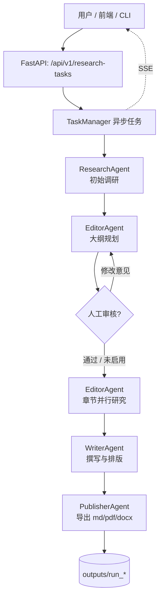

# DS Reporter

DS Reporter 是一个基于 LangGraph 的自动化深度研究（Deep Research）与报告生成系统。输入一个研究问题，系统会自主完成初始调研、报告大纲规划、分章节并行研究、正文撰写、格式排版与多格式导出，输出带引用的 Markdown / PDF / DOCX 研究报告。

项目提供三种使用方式：Web 前端 + FastAPI 异步任务接口、命令行一键运行、LangGraph Studio 可视化调试。

## 功能特性

- **多智能体协作**：Editor（规划）、Researcher（调研）、Reviewer / Reviser（审核修订）、Writer（撰写）、Publisher（排版发布）分工协作。
- **两阶段调研**：先做一次全局初始调研，再按大纲对每个章节并行深挖。
- **人在回路（Human-in-the-loop）**：可在计划生成后人工审核大纲，选择接受或提交修改意见，支持修订次数上限。
- **实时流式输出**：基于 SSE 推送任务状态、阶段进度与报告正文增量。
- **多格式导出**：Markdown、PDF、DOCX。
- **多搜索源**：Tavily、DuckDuckGo、arXiv、xquik（可通过配置切换）。
- **OpenAI 兼容接口**：支持 OpenAI、DeepSeek 等任意 OpenAI 兼容模型服务。
- **Web 界面**：React + Vite 单页应用，表单创建任务、查看进度、审核大纲、预览与下载报告。

## 系统架构



LangGraph 工作流节点与顺序：

```
browser → planner → human → researcher → writer → publisher → END
```

## 目录结构

```
dsreporter/
├── app/                     # FastAPI 服务层
│   ├── main.py              # 应用入口、全局异常处理
│   ├── schemas.py           # 请求/响应模型
│   ├── routes/              # 研究任务 REST + SSE 路由
│   └── services/            # 任务编排、状态管理、产物扫描
├── dsreporter/              # 核心研究引擎（检索、抓取、上下文、写作）
│   ├── actions/             # 搜索、检索器、Markdown 处理等动作
│   ├── retrievers/          # Tavily / DuckDuckGo / arXiv / xquik
│   ├── scraper/             # BeautifulSoup / PyMuPDF 网页与 PDF 解析
│   ├── skills/              # 研究、写作、上下文、来源筛选等能力
│   ├── config/              # 配置加载与默认值
│   ├── memory/              # 向量化与记忆
│   └── agent.py             # DSReporter 核心类
├── multi_agents/            # LangGraph 多智能体编排
│   ├── agents/              # orchestrator / editor / researcher / writer / publisher ...
│   ├── memory/              # 图状态定义
│   └── agent.py             # LangGraph 图导出（供 langgraph dev 使用）
├── frontend/                # React + Vite 前端
├── main.py                  # CLI：从 task.json 运行完整流程
├── stream_report_cli.py     # CLI：调用 HTTP 接口并流式打印报告
├── task.json                # CLI 使用的研究任务配置
├── langgraph.json           # LangGraph 平台配置
├── requirements.txt
└── .env.example
```

## 快速开始

### 环境要求

- Python 3.11+
- Node.js 18+
- 一个可用的 LLM API Key（OpenAI 或任意 OpenAI 兼容服务）

### 1. 安装依赖

```bash
git clone <your-repo-url>
cd dsreporter

python -m venv .venv
# Windows
.venv\Scripts\activate
# macOS / Linux
source .venv/bin/activate

pip install -r requirements.txt
```

### 2. 配置环境变量

复制 `.env.example` 为 `.env` 并填写：

```env
# 必填：模型服务
OPENAI_API_KEY=sk-xxx
# 可选：OpenAI 兼容服务地址（如 DeepSeek）
# OPENAI_BASE_URL=https://api.deepseek.com/v1

# 搜索服务（使用对应检索器时需要）
TAVILY_API_KEY=
XQUIK_API_KEY=

# 可选：本地文档目录（仅 source=local 时需要）
# DOC_PATH=./my-docs
```

> 若未设置 `OPENAI_API_KEY`，程序会回退读取 `DEEPSEEK_API_KEY`。请在提交代码前确认 `.env` 已被 `.gitignore` 忽略。

### 3. 启动后端

```bash
uvicorn app.main:app --reload --port 8000
```

接口文档：http://127.0.0.1:8000/docs

### 4. 启动前端

```bash
cd frontend
npm install
npm run dev
```

访问 http://127.0.0.1:5173 。Vite 已将 `/api` 代理到 `http://127.0.0.1:8000`。

## 使用方式

### 方式一：Web 界面

1. 填写研究问题、模型名称（如 `deepseek-chat`、`gpt-4o-mini`）、语言、章节数。
2. 选择导出格式（Markdown / PDF / DOCX）。
3. 可选：开启「人工审核大纲」，任务会在规划完成后暂停等待审核。
4. 提交后实时查看阶段进度与报告正文，完成后下载产物。

### 方式二：命令行（直接跑 LangGraph 流程）

编辑 `task.json`：

```json
{
  "query": "生成式 AI 在企业的落地现状与瓶颈",
  "max_sections": 3,
  "max_plan_revisions": 3,
  "publish_formats": { "markdown": true, "pdf": true, "docx": true },
  "include_human_feedback": false,
  "follow_guidelines": false,
  "model": "deepseek-chat",
  "source": "web",
  "language": "简体中文",
  "guidelines": [],
  "verbose": true
}
```

运行：

```bash
python main.py
# 或临时覆盖研究问题
python main.py "你的研究问题"
```

结果会写入 `outputs/run_<task_id>_<query>/`。

### 方式三：命令行（走 HTTP 接口并流式输出）

先启动后端，再执行：

```bash
python stream_report_cli.py --query "AI 生产力效应的多维证据" --max-sections 1
```

常用参数：

| 参数 | 默认值 | 说明 |
| --- | --- | --- |
| `--base-url` | `http://127.0.0.1:8000` | 后端地址 |
| `--query` | 内置示例 | 研究问题 |
| `--model` | `deepseek-chat` | 模型名称 |
| `--language` | `简体中文` | 报告语言 |
| `--max-sections` | `1` | 章节数 |
| `--request-timeout` | `30` | 单次请求超时（秒） |
| `--stream-timeout` | `1800` | SSE 流超时（秒） |

### 方式四：LangGraph Studio

安装了 LangGraph CLI 后，在项目根目录执行：

```bash
langgraph dev
```

图定义位于 `multi_agents/agent.py:graph`，研究问题在文件内配置。

## API 说明

Base path：`/api/v1/research-tasks`

| 方法 | 路径 | 说明 |
| --- | --- | --- |
| `POST` | `/` | 创建异步研究任务，返回 `202` 与任务 ID |
| `GET` | `/` | 分页查询任务列表，支持 `status`、时间范围过滤 |
| `GET` | `/{task_id}` | 查询任务详情、阶段、进度与错误 |
| `GET` | `/{task_id}/plan-review` | 获取待审核的大纲 |
| `POST` | `/{task_id}/plan-review` | 提交审核结果（`accept` / `revise`） |
| `GET` | `/{task_id}/result` | 获取完整结果（大纲、章节内容、正文、来源） |
| `GET` | `/{task_id}/artifacts` | 列出已生成的产物 |
| `GET` | `/{task_id}/artifacts/{format}/content` | 下载产物（`markdown` / `pdf` / `docx`） |
| `GET` | `/{task_id}/events` | SSE 实时事件流 |

创建任务示例：

```bash
curl -X POST http://127.0.0.1:8000/api/v1/research-tasks \
  -H "Content-Type: application/json" \
  -d '{
    "query": "生成式 AI 在企业的落地现状与瓶颈",
    "model": "deepseek-chat",
    "source": "web",
    "language": "简体中文",
    "max_sections": 3,
    "max_plan_revisions": 3,
    "publish_formats": {"markdown": true, "pdf": true, "docx": false},
    "include_human_feedback": false,
    "follow_guidelines": false,
    "guidelines": [],
    "verbose": false
  }'
```

任务状态：`queued`、`running`、`awaiting_plan_review`、`completed`、`completed_with_warnings`、`failed`。

SSE 事件类型：`snapshot`、`status`、`stage`、`progress`、`plan_review_required`、`report_start`、`report_delta`、`report_end`。

## 配置项

### 检索器

通过环境变量 `RETRIEVER` 指定，支持：

- `tavily`（默认，需 `TAVILY_API_KEY`）
- `duckduckgo`
- `arxiv`
- `xquik`（需 `XQUIK_API_KEY`）

也可用逗号分隔组合多个检索器。

### 模型

| 环境变量 | 默认值 | 用途 |
| --- | --- | --- |
| `FAST_LLM` | `openai:gpt-4o-mini` | 轻量任务 |
| `SMART_LLM` | `openai:gpt-4.1` | 报告撰写 |
| `STRATEGIC_LLM` | `openai:o4-mini` | 规划类任务 |
| `EMBEDDING` | `openai:text-embedding-3-small` | 向量化 |

格式为 `provider:model`。API 任务中的 `model` 字段用于覆盖大纲与正文生成所用模型。

### 其他

- `RESEARCH_TASK_TIMEOUT_SECONDS`：任务超时时间，默认 `1800` 秒。
- 完整默认配置见 [`dsreporter/config/variables/default.py`](dsreporter/config/variables/default.py)。

## 产物

每次运行会在 `outputs/run_<task_id>_<query>/` 下生成：

- `*.md`：Markdown 报告
- `*.pdf`：PDF 报告（可选）
- `*.docx`：Word 报告（可选）

`outputs/` 已在 `.gitignore` 中忽略。

## 说明

- 研究报告由大模型生成，事实性内容请结合原文来源自行核验。
- PDF/DOCX 转换依赖中文字体环境；若出现乱码或转换失败，任务会以 `completed_with_warnings` 返回，并附带 `ARTIFACT_CONVERSION_FAILED` 警告。
- Windows 控制台默认 GBK 编码可能导致输出异常，入口脚本已强制使用 UTF-8。
